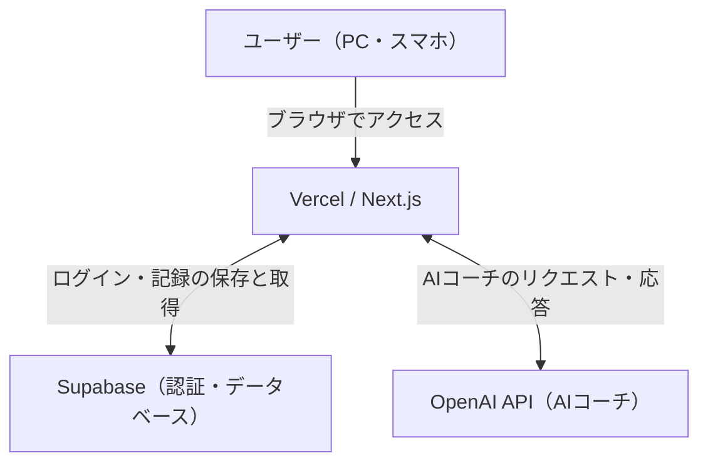

# 💪 MuscleAI

**トレーニング記録・成長分析・AIコーチ機能を備えた筋トレ管理Webアプリ**

MuscleAIは、日々のトレーニングを記録し、重量・回数・セット数などのデータから成長を可視化するWebアプリケーションです。

筋力の成長を数値で確認できるほか、トレーニング履歴に応じたアドバイスを受けられるAIコーチ機能を搭載しています。

## 🚀 主な機能

- **ユーザー認証**：Supabase Authenticationによるログイン
- **トレーニング記録**：種目ごとの重量・回数・セット数の登録
- **成長グラフ**：推定1RM【正しいフォームで1回だけ持ち上げられる限界の重量】や総ボリューム【重量 × 回数 × セット数】の推移を可視化
- **パーソナルレコード管理**：自己ベストや記録更新の確認
- **AIコーチ**：トレーニング履歴に基づいたアドバイス
- **レスポンシブ対応**：PC・スマートフォンで利用可能

## 🛠 使用技術

| 分類 | 技術 |
|---|---|
| フロントエンド | Next.js / React / TypeScript |
| スタイリング | Tailwind CSS |
| データベース・認証 | Supabase |
| グラフ表示 | Recharts |
| AI機能 | OpenAI API |
| E2Eテスト | Playwright |
| CI | GitHub Actions |
| コンテナ | Docker |
| デプロイ | Vercel |

## 🌐 デモ

https://muscle-ai-eight.vercel.app/

※ アプリの利用にはログインが必要です。

## 🧪 テスト・開発環境

Playwrightを使用して、ログインからトレーニングセット追加までのE2Eテストを実装しています。

GitHub Actionsでは、GitHubへのpush時に自動テストを実行するCIワークフローを構築しました。

Dockerでは、開発環境でのコンテナ起動に加え、マルチステージビルドによる本番実行用イメージの作成と動作確認を行っています。

## 📌 今後の改善予定

- テストケースの拡充
- エラーハンドリングと使いやすさの改善
- Dockerを利用した開発・運用手順の整備
- セキュリティとパフォーマンスの改善


## 🏗️ システム構成図



### 開発・テスト環境

- **GitHub**：ソースコード管理
- **GitHub Actions**：CIによる自動テスト
- **Playwright**：ブラウザ操作の自動テスト
- **Docker**：開発環境とは別に、アプリの実行環境をコンテナ化


## テスト・品質保証（QA）

MuscleAIでは、Playwrightを使用したE2Eテストと、GitHub ActionsによるCI（継続的インテグレーション）を導入しています。

### テスト内容

| テスト項目 | 検証内容 |
|---|---|
| ログイン機能 | テスト用アカウントA・Bで正常にログインできること |
| トレーニング入力 | 入力チェックとセット追加が正常に動作すること |
| データ分離 | アカウントAに記録が存在することを確認し、アカウントBからその記録を取得できないこと |
| アクセス制御 | Supabase RLSによるユーザー単位のデータアクセス制御を検証 |

### テスト実行方法

Playwrightのブラウザをインストールします。

```bash
npx playwright install
```

アプリを起動します。

```bash
npm run dev
```

別のターミナルでテストを実行します。

```bash
npx playwright test
```

アカウント分離テストのみ実行する場合：

```bash
npx playwright test tests/account-isolation.spec.ts --project=webkit
```

※ テストには、Supabaseの接続設定と2つのテスト用アカウントの認証情報が必要です。認証情報は環境変数で管理し、GitHubには登録しません。

### CI（GitHub Actions）

GitHubへのpush時にPlaywrightの自動テストを実行する仕組みを構築しています。

2026年10月13日時点で、アカウント分離テスト強化後のGitHub Actions実行（#11）が成功しました。

### 品質保証で意識したこと

- 正常系だけでなく、異なるユーザー間のデータアクセスも検証する
- テスト対象の記録が実際に存在することを確認し、誤ったテスト成功を防ぐ
- ローカル環境だけでなくCI環境でもテストを実行し、変更による不具合の早期発見につなげる


## Kubernetes 構築・QA検証

MuscleAIをDocker Desktop上のローカルKubernetes環境で動作させ、DeploymentによるPod管理、障害復旧、ConfigMap・Secretによる設定管理を検証しました。

### 検証環境

- Kubernetes：Docker Desktop（ローカル、単一Node）
- コンテナイメージ：`muscle-ai-prod:latest`
- Deployment：`muscle-ai`
- レプリカ数：3
- Service：ClusterIP、TCP 3000
- 設定管理：ConfigMap / Secret

### 検証結果

| テスト項目 | 期待結果 | 実際の結果 | 判定 |
|---|---|---|---|
| コンテナ起動 | Podが正常に起動する | `1/1 Running` を確認 | PASS |
| レプリカ数変更 | Podが3個になる | 3個とも `1/1 Running` | PASS |
| Pod削除後の自動復旧 | 削除後に新しいPodが作成される | 新しいPodが自動生成された | PASS |
| Deployment更新 | 3個のPodが正常稼働する | `3/3 Ready` を確認 | PASS |
| ConfigMap参照 | `APP_ENV=local` が設定される | `printenv APP_ENV` で `local` を確認 | PASS |
| Secret参照 | ダミーの環境変数が設定される | 値を表示せず `SECRET_OK` を確認 | PASS |

### Pod自動復旧テスト

**目的：** Deploymentが管理するPodを削除した場合、指定したレプリカ数が自動的に維持されることを確認する。

**手順：**

1. `kubectl scale deployment muscle-ai --replicas=3` でPodを3個に設定する。
2. `kubectl get pods -l app=muscle-ai` で稼働状態を確認する。
3. `kubectl delete pod <Pod名>` でPodを1個削除する。
4. 再度Pod一覧を取得する。

**結果：** 削除したPodとは異なる名前のPodが新たに作成され、3個とも `1/1 Running` になった。

**判定：PASS**

### ConfigMap・Secret参照テスト

ConfigMapの `APP_ENV` をDeploymentから参照し、Pod内で `local` と表示されることを確認しました。

また、ダミー値を登録したKubernetes SecretをDeploymentから参照し、Pod内で環境変数が空でないことを `SECRET_OK` で確認しました。

実際のAPIキーやパスワードはテストに使用していません。

### 使用した主なコマンド

~~~bash
kubectl get deployments,pods -l app=muscle-ai
kubectl scale deployment muscle-ai --replicas=3
kubectl delete pod <Pod名>
kubectl apply --dry-run=client -f k8s/deployment.yaml
kubectl diff -f k8s/deployment.yaml
kubectl apply -f k8s/deployment.yaml
kubectl exec <Pod名> -c muscle-ai -- printenv APP_ENV
~~~

### 検証範囲・制限事項

- ローカルの単一Node環境で検証しており、Node障害時の可用性は未検証です。
- Podの自動再作成は確認しましたが、ユーザー通信が無停止だったことまでは検証していません。
- Secretについては環境変数の存在確認までで、RBACや暗号化設定の検証は実施していません。
- コンテナイメージはローカルKubernetes環境へ手動で取り込んでいます。別環境での再現にはイメージの準備が必要です。
- Deploymentが参照する `muscle-ai-demo-secret` は、デプロイ前に別途作成する必要があります。

### QAとして意識した点

設定変更前にDry Runと差分確認を実施し、変更後はDeploymentとPodの状態を確認しました。

また、Pod削除による障害再現と復旧確認を行い、期待結果と実際の結果を比較しました。
