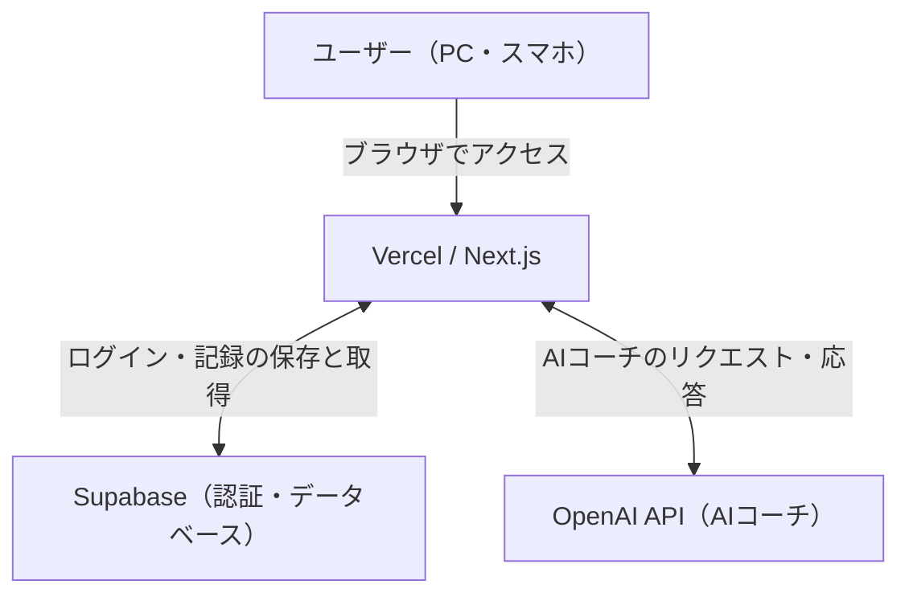

# 💪 MuscleAI

**トレーニング記録・成長分析・AIコーチ機能を備えた筋トレ管理Webアプリ**

MuscleAIは、日々のトレーニングを記録し、重量・回数・セット数などのデータから成長を可視化するWebアプリケーションです。

筋力の成長を数値で確認できるほか、トレーニング履歴に応じたアドバイスを受けられるAIコーチ機能を搭載しています。

## 🚀 主な機能

- **ユーザー認証**：Supabase Authenticationによるログイン
- **トレーニング記録**：種目ごとの重量・回数・セット数の登録
- **成長グラフ**：推定1RM【正しいフォームで1回だけ持ち上げられる限界の重量】や総ボリューム【重量 × 回数 × セット数】の推移を可視化
- **パーソナルレコード管理**：自己ベストや記録更新の確認
- **AIコーチ**：トレーニング履歴に基づいたアドバイス
- **レスポンシブ対応**：PC・スマートフォンで利用可能

## 🛠 使用技術

| 分類 | 技術 |
|---|---|
| フロントエンド | Next.js / React / TypeScript |
| スタイリング | Tailwind CSS |
| データベース・認証 | Supabase |
| グラフ表示 | Recharts |
| AI機能 | OpenAI API |
| E2Eテスト | Playwright |
| CI | GitHub Actions |
| コンテナ | Docker |
| デプロイ | Vercel |

## 🌐 デモ

https://muscle-ai-eight.vercel.app/

※ アプリの利用にはログインが必要です。

## 🧪 テスト・開発環境

Playwrightを使用して、ログインからトレーニングセット追加までのE2Eテストを実装しています。

GitHub Actionsでは、GitHubへのpush時に自動テストを実行するCIワークフローを構築しました。

Dockerでは、開発環境でのコンテナ起動に加え、マルチステージビルドによる本番実行用イメージの作成と動作確認を行っています。

## 📌 今後の改善予定

- テストケースの拡充
- エラーハンドリングと使いやすさの改善
- Dockerを利用した開発・運用手順の整備
- セキュリティとパフォーマンスの改善

## 🏗️ システム構成図

### 開発・テスト環境

- **GitHub**：ソースコード管理
- **GitHub Actions**：CIによる自動テスト
- **Playwright**：ブラウザ操作の自動テスト
- **Docker**：開発環境とは別に、アプリの実行環境をコンテナ化
